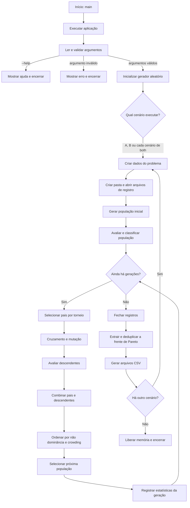

# Fluxo de funcionamento do programa

## 1. Visão geral

Este programa implementa, em C, uma versão acadêmica do algoritmo evolutivo multiobjetivo **NSGA-II**. Seu objetivo é encontrar diferentes soluções para destinar lotes de resíduos perigosos a instalações receptoras e agrupá-los em viagens.

Cada solução tenta minimizar simultaneamente três valores:

1. **custo simulado** de tratamento e transporte;
2. **risco simulado de transporte**;
3. **risco simulado das instalações**.

Como esses objetivos podem entrar em conflito, o programa não procura apenas uma solução. Ao final, ele exporta uma **frente de Pareto**, formada por soluções factíveis para as quais nenhuma outra solução é melhor em todos os objetivos ao mesmo tempo.

## 2. Fluxo geral



## 3. Ponto de entrada e configuração

O ponto de entrada está em `src/main.c`. A função `main` apenas repassa os argumentos da linha de comando para `executarAplicacao`, definida em `src/aplicacao.c`.

```text
main
└── executarAplicacao
    ├── lerArgumentos
    ├── iniciarGerador
    ├── criarProblema
    ├── abrirRegistro
    ├── executarNSGA2ComRegistro
    ├── fecharRegistro
    ├── salvarResultados
    └── liberarPopulacao
```

A configuração padrão é criada por `criarConfiguracaoPadrao`, em `src/modelo.c`:

| Parâmetro | Valor padrão |
|---|---:|
| Cenário | `both` |
| População | `100` indivíduos |
| Gerações | `200` |
| Semente aleatória | `20261102` |
| Nível de log | `summary` |
| Intervalo do log | `10` gerações |
| Diretório de saída | `results` |
| Exportar indivíduos | não |

Os argumentos aceitos são:

```text
programa [A|B|both] [populacao] [geracoes] [opcoes]

--log quiet|summary|steps|full
--every N
--seed N
--output DIRETORIO
--individuals
--help
```

Se os argumentos forem inválidos, o programa apresenta o erro e a ajuda. A população deve ter pelo menos quatro indivíduos, e a quantidade de gerações e o intervalo de log devem ser maiores ou iguais a um.

## 4. Montagem do problema

A função `criarProblema`, em `src/problema.c`, monta na memória um dos dois cenários:

- **Cenário A:** lotes hipotéticos relacionados ao SSL Thamirabarani;
- **Cenário B:** quantidades aproximadas do inventário de um navio-modelo.

Cada problema contém:

- 7 lotes de resíduos;
- 6 instalações receptoras;
- tipos aceitos por cada instalação;
- capacidade de cada instalação;
- custo e risco local de cada instalação;
- distância e coeficiente de risco rodoviário;
- matriz de incompatibilidade entre tipos de resíduos;
- capacidade de 150 kg por veículo;
- custos fixo e por quilômetro de cada viagem.

A função `validarProblema` existe para verificar a consistência desses dados, mas **não é chamada pelo fluxo principal atual**. Os cenários A e B são criados diretamente a partir de dados fixos no código.

Quando a opção `both` é usada, o gerador pseudoaleatório é inicializado uma única vez antes do laço dos cenários. Portanto, o cenário B continua a sequência aleatória consumida pelo cenário A; a semente não é reiniciada entre eles.

## 5. Representação de uma solução

Uma solução é representada pela estrutura `Individuo`, declarada em `include/modelo.h`.

Cada indivíduo possui dois conjuntos principais de genes:

| Gene | Significado |
|---|---|
| `destino[lote]` | instalação escolhida para receber o lote |
| `prioridade[lote]` | ordem usada para tentar agrupar os lotes em viagens |

Além dos genes, o indivíduo guarda:

- os três objetivos calculados;
- a penalidade total por violações;
- a quantidade de viagens;
- o `rank` da frente de não dominância;
- a distância de aglomeração (`crowding`).

Uma população é um vetor dinâmico de indivíduos. A memória desse vetor é criada por `alocarPopulacao` e liberada por `liberarPopulacao`.

## 6. População inicial

`inicializarPopulacao` cria a quantidade configurada de indivíduos. Para cada um deles, `criarIndividuoAleatorio`:

1. percorre todos os lotes;
2. identifica as instalações que aceitam o tipo do lote;
3. sorteia uma instalação elegível;
4. cria e embaralha as prioridades dos lotes;
5. avalia imediatamente a solução criada.

Depois que toda a população inicial foi criada, `classificarPopulacao` calcula as frentes de não dominância e o crowding de cada frente.

## 7. Avaliação de um indivíduo

A avaliação é feita por `avaliarIndividuo`, em `src/avaliacao.c`.

### 7.1 Destinação dos lotes

Para cada lote, a função:

- lê o destino indicado no cromossomo;
- acumula a massa destinada à instalação;
- verifica se a instalação aceita o tipo do resíduo;
- soma o custo de tratamento;
- soma o risco local da instalação.

Em forma simplificada:

```text
custo de tratamento += massa × custo por kg da instalação
risco local          += massa × risco local por kg
```

### 7.2 Formação das viagens

Os lotes são agrupados por instalação e ordenados pelo gene de prioridade. Em seguida, o avaliador tenta colocar cada lote na primeira viagem existente que:

- ainda tenha capacidade disponível;
- não contenha um tipo de resíduo incompatível.

Se nenhuma viagem puder receber o lote, uma nova viagem é criada. Todas as viagens vão para apenas uma instalação e consideram ida e volta.

Para cada viagem:

```text
quilômetros       = 2 × distância da instalação
custo de viagem   = custo fixo + quilômetros × custo por km
risco de transporte = quilômetros × coeficiente rodoviário × carga da viagem
```

### 7.3 Restrições e penalidades

A propriedade `violacao` aumenta quando ocorre uma situação inválida, por exemplo:

- destino fora do intervalo das instalações;
- instalação que não aceita o tipo do lote;
- capacidade total da instalação excedida;
- lote maior que a capacidade do veículo.

Um indivíduo é considerado factível quando sua violação é praticamente zero (`violacao < 1e-8`).

## 8. Classificação por não dominância

A lógica está em `src/dominancia.c`.

Ao comparar dois indivíduos:

1. uma solução factível domina uma solução inviável;
2. entre duas soluções inviáveis, vence a de menor violação;
3. entre duas soluções factíveis, aplica-se a dominância de Pareto;
4. para dominar, uma solução não pode ser pior em nenhum objetivo e deve ser estritamente melhor em pelo menos um.

`classificarPopulacao` compara os indivíduos, monta as frentes e atribui ranks:

- `rank = 0`: primeira frente, não dominada;
- `rank = 1`: segunda frente;
- e assim sucessivamente.

Dentro de cada frente também é calculada a **crowding distance**. Os extremos de cada objetivo recebem distância infinita, enquanto os demais recebem uma medida normalizada do espaço ao redor. Esse valor ajuda a preservar soluções variadas ao longo da frente de Pareto.

## 9. Ciclo evolutivo do NSGA-II

O ciclo principal está em `executarNSGA2ComRegistro`, em `src/evolucao.c`.

Para cada geração, o programa executa:

### 9.1 Seleção por torneio

`selecionarTorneio` sorteia dois indivíduos e escolhe:

1. o de menor rank;
2. em caso de empate, o de maior crowding;
3. persistindo o empate, um dos dois aleatoriamente.

### 9.2 Cruzamento

`cruzarIndividuos` combina dois pais:

- cada gene de destino pode vir de qualquer um dos pais, com probabilidade de 50%;
- as prioridades dos dois pais são combinadas e reorganizadas para continuarem formando uma ordem válida.

### 9.3 Mutação

`mutarIndividuo` aplica duas formas de alteração:

- cada gene de destino tem probabilidade de 14% de ser trocado por outro destino elegível;
- o indivíduo tem probabilidade de 40% de trocar a prioridade de dois lotes.

O descendente é então avaliado novamente.

### 9.4 Seleção ambiental elitista

Pais e filhos são unidos em uma população temporária com tamanho `2N`. A função `selecionarAmbiente`:

1. classifica a população combinada por não dominância;
2. percorre as frentes do menor para o maior rank;
3. dentro de cada frente, prioriza o maior crowding;
4. copia os melhores indivíduos até formar a próxima população de tamanho `N`.

Assim, boas soluções dos pais podem sobreviver, mesmo quando não foram recriadas entre os descendentes.

## 10. Registro durante a execução

O módulo `src/registro.c` cria o diretório de saída e registra o andamento do algoritmo.

As dez etapas didáticas gravadas em `steps.csv` são:

1. população inicial;
2. codificação dos cromossomos;
3. avaliação e classificação;
4. seleção por torneio;
5. cruzamento;
6. mutação;
7. ordenação por não dominância;
8. distância de aglomeração;
9. seleção ambiental;
10. critério de parada.

Essas etapas descrevem o processo, mas algumas operações são recalculadas em mais de um ponto. Por exemplo, a população é classificada antes da reprodução, durante a seleção ambiental e novamente após a formação da nova geração.

## 11. Encerramento e arquivos de saída

Depois da última geração, `salvarResultados`, em `src/exportacao.c`:

1. classifica novamente a população final;
2. seleciona os indivíduos factíveis de `rank = 0`;
3. ordena as soluções pelos três objetivos;
4. remove duplicatas com os mesmos objetivos e destinos;
5. grava os arquivos finais;
6. mostra no terminal a quantidade de soluções e a solução de menor custo.

Para cada cenário é criada uma pasta `case_A` ou `case_B` dentro do diretório configurado.

| Arquivo | Conteúdo |
|---|---|
| `pareto.csv` | soluções finais não dominadas, factíveis e deduplicadas |
| `inventory.csv` | lotes e quantidades do cenário |
| `facilities_SIMULATED.csv` | instalações e seus parâmetros simulados |
| `steps.csv` | etapas registradas em cada geração |
| `generations.csv` | resumo estatístico de cada geração |
| `individuals.csv` | indivíduos, genes e objetivos, quando `--individuals` é usado |

## 12. Responsabilidade dos módulos

| Módulo | Responsabilidade principal |
|---|---|
| `main.c` | ponto de entrada |
| `aplicacao.c` | argumentos, cenários e coordenação geral |
| `modelo.c` / `modelo.h` | estruturas de dados e configuração padrão |
| `problema.c` | dados dos cenários, elegibilidade e validação do problema |
| `aleatorio.c` | geração pseudoaleatória reproduzível |
| `avaliacao.c` | objetivos, viagens e penalidades |
| `operadores.c` | população aleatória, torneio, cruzamento e mutação |
| `dominancia.c` | dominância, frentes e crowding |
| `ordenacao.c` | ordenação auxiliar compatível com a referência usada pelo projeto |
| `evolucao.c` | ciclo do NSGA-II e gerenciamento das populações |
| `registro.c` | logs, estatísticas e CSVs intermediários |
| `exportacao.c` | extração da frente de Pareto e CSVs finais |

## 13. Programa breve

O pseudocódigo abaixo resume a ideia do programa. Ele é propositalmente simplificado e não reproduz todos os detalhes da implementação em C.

```portugol
programa
{
    funcao inicio()
    {
        configuracao = ler_argumentos_ou_usar_padrao()
        iniciar_aleatoriedade(configuracao.semente)

        para cada cenario escolhido em configuracao
        {
            problema = criar_problema(cenario)
            abrir_arquivos_de_saida(cenario)

            populacao = criar_populacao_aleatoria(
                configuracao.populacao,
                problema
            )

            avaliar_todos(populacao, problema)
            classificar_por_pareto_e_crowding(populacao)

            para geracao de 1 ate configuracao.geracoes
            {
                filhos = lista_vazia()

                enquanto tamanho(filhos) < configuracao.populacao
                {
                    pai1 = torneio(populacao)
                    pai2 = torneio(populacao)

                    filho = cruzar(pai1, pai2)
                    mutar(filho, problema)
                    avaliar(filho, problema)

                    adicionar(filhos, filho)
                }

                candidatos = juntar(populacao, filhos)
                classificar_por_pareto_e_crowding(candidatos)

                populacao = escolher_melhores(
                    candidatos,
                    configuracao.populacao
                )

                registrar_resultados_da_geracao(populacao, geracao)
            }

            frente_pareto = pegar_factíveis_do_primeiro_rank(populacao)
            frente_pareto = remover_duplicados(frente_pareto)

            salvar_csvs(frente_pareto, problema)
            fechar_arquivos()
        }
    }

    funcao avaliar(individuo, problema)
    {
        zerar_objetivos_e_violacoes(individuo)

        para cada lote do problema
        {
            destino = individuo.destino[lote]
            somar_custo_de_tratamento(lote, destino)
            somar_risco_da_instalacao(lote, destino)
            verificar_restricoes(lote, destino)
        }

        viagens = agrupar_lotes_por_destino_capacidade_e_compatibilidade()

        para cada viagem em viagens
        {
            somar_custo_da_viagem(viagem)
            somar_risco_de_transporte(viagem)
        }
    }
}
```

## 14. Resumo em uma frase

O programa cria várias formas de destinar e transportar os lotes, avalia custo e riscos, evolui essas soluções com o NSGA-II e exporta as alternativas finais que representam os melhores compromissos encontrados.
